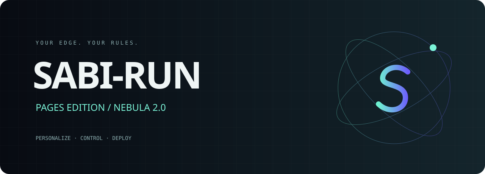
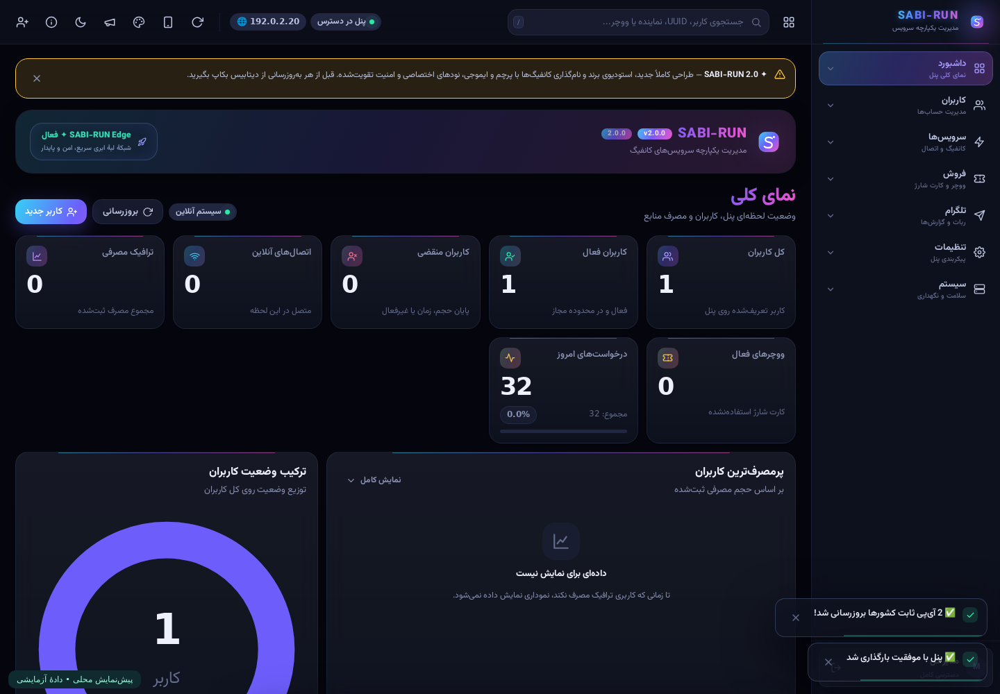
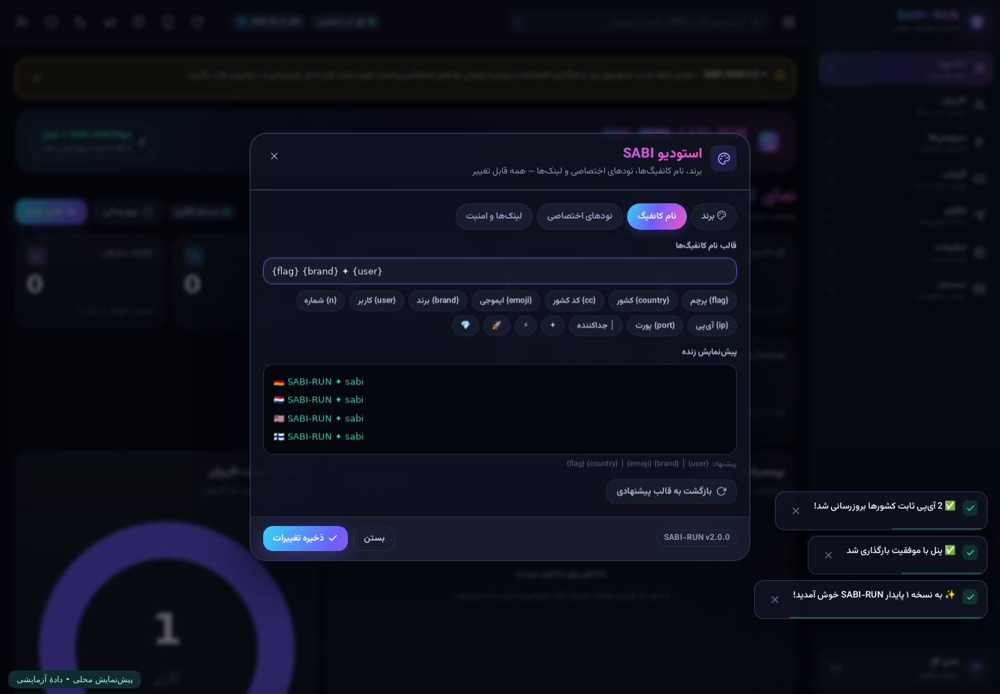
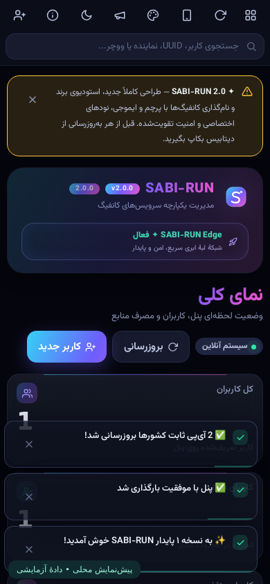
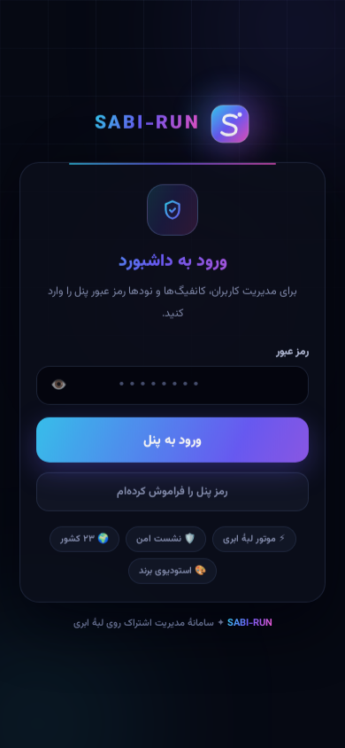

<div align="center">

<br><br>
<a href="https://sabi-karami.github.io/SABI-RUN/"></a>


**پنل فارسی مدیریت اشتراک · طراحی Nebula · استودیوی شخصی‌سازی**

[صفحهٔ معرفی و نصب](https://sabi-karami.github.io/SABI-RUN/) · [نتایج تست](TEST-RESULTS.json) · [امنیت](SECURITY.md) · [راهنمای نصب](DEPLOY.md)
</div>

> **وضعیت واقعی انتشار — ۲۳ اکتبر ۲۰۲۶:** اولین استقرار روی `https://sabi-run.pages.dev/panel` موفق بود؛ ورود مدیر و داشبورد پاسخ ۲۰۰ دادند. انتشار اصلاحات بعدی با پیام Cloudflare **8000119: Your Pages project has been blocked** رد شد. آخرین سورس این مخزن روی آن آدرس منتشر نشده است. برای رفع محدودیت با `abusereply@cloudflare.com` تماس بگیرید؛ پروژهٔ جایگزین برای دورزدن محدودیت نسازید.
>
> **نصب آنلاین آماده نیست.** فیلد توکن در صفحهٔ GitHub Pages عمداً غیرفعال است تا کاربران توکن خود را به سرویس راه‌اندازی‌نشده نسپارند. کد سرویس واسط و نصب‌کنندهٔ محلی موجود است، اما نصب سرتاسری آخرین نسخه هنوز تأیید نشده.

## ✦ چه چیزهایی تغییر کرده؟

| بخش | امکانات |
|---|---|
| طراحی | رابط راست‌به‌چپ، کارت‌های نیمه‌شفاف، هفت پوسته، لوگوی جدید S، صفحات ورود و راه‌اندازی جدید، چیدمان موبایل |
| استودیو | تغییر برند، قالب نام کانفیگ با پیش‌نمایش زنده، لینک‌های تلگرام/سایت، فهرست نودهای اختصاصی |
| مدیریت کاربران | ایجاد، ویرایش، فعال/غیرفعال، حجم و تاریخ انقضا، خروجی اشتراک، نمایندگان |
| نودها | ورودی IP یا دامنه و پورت، کد کشور، حالت ترکیبی یا فقط اختصاصی |
| امنیت | احراز هویت APIهای مدیریتی، جداسازی دسترسی نماینده، نشست نمک‌دار و ابطال نشست‌ها، کنترل Origin، اعتبارسنجی وبهوک تلگرام |
| انتشار | Cloudflare **Pages + D1**، ابزار نصب محلی، کد سرویس نصب مرورگری، بررسی SHA-256 نسخه |

هیچ قفل تجاری یا پرداختی اضافه نشده است. بعضی بخش‌های قدیمی هنوز نیاز به آزمون و بازطراحی بیشتر دارند؛ این نسخه ادعای کامل‌بودن همهٔ امکانات یا بی‌نقص‌بودن امنیت ندارد.

## 🎨 پیش‌نمایش

تصاویر زیر از **آخرین نسخهٔ محلی با دادهٔ آزمایشی** هستند، نه تأیید سلامت تونل یا آمار واقعی کاربران.



<details><summary><b>استودیو، موبایل و ورود</b></summary>
<br>

<table><tr><td></td><td></td></tr></table>
</details>

## 🌍 نام کانفیگ‌ها

قالب پیشنهادی:

```text
{flag} {country} │ {emoji} {brand} │ {user}
```

نمونهٔ نمایشی:

```text
🇩🇪 آلمان │ 🚀 SABI-RUN │ sabi
🇳🇱 هلند │ ⚡ SABI-RUN │ sabi
```

متغیرها: `{flag}`، `{country}`، `{cc}`، `{emoji}`، `{brand}`، `{user}`، `{n}`، `{ip}`، `{port}`.

**پرچم از برچسب کشور نود ساخته می‌شود.** این برچسب یا فایل IP، اثبات کشور واقعی خروجی، مالکیت IP یا دسترس‌پذیری سرور نیست. آدرس‌های anycast کلادفلر نیز کشور خروجی ثابت را تضمین نمی‌کنند.

برای نود اختصاصی، در استودیو هر خط را این‌گونه وارد کنید:

```text
# نمونهٔ فرمت؛ این آدرس‌ها سرور قابل استفاده نیستند
192.0.2.10:443 DE
node.example.com:8443 NL
```

## 🚀 نصب

[راهنمای کامل](DEPLOY.md) را بخوانید. روش پیشنهادی فعلی، نصب محلی پس از رفع محدودیت کلادفلر است:

```bash
git clone https://github.com/sabi-karami/SABI-RUN.git
cd SABI-RUN
python3 installer/install.py
```

- Python 3.10+؛ بدون وابستگی جانبی.
- توکن و رمز از طریق ورودی مخفی ترمینال دریافت می‌شوند؛ داخل مخزن یا فایل تنظیمات نوشته نمی‌شوند.
- رمز مدیریت **پیش از عمومی‌شدن پنل** در D1 تنظیم می‌شود.
- نصب‌کننده منابع تازه می‌سازد و دیتابیس یا رمز نصب قبلی را بازنویسی نمی‌کند.
- پس از نصب، توکن موقت را لغو کنید.
- شکست مرحله‌ای ممکن است دیتابیس/پروژهٔ نیمه‌ساخته باقی بگذارد؛ ابزار حذف خودکار و مخرب انجام نمی‌دهد.

### تفاوت Pages و Worker

این بسته از فایل `_worker.js` در حالت پیشرفتهٔ **Pages Functions** استفاده می‌کند. وجود این نام فایل به معنی ساخت Worker مستقل نیست؛ پروژه از نوع Pages و آدرس آن `*.pages.dev` است.

**Pages کرون داخلی ندارد.** بررسی‌های درخواست‌محور پنل اجرا می‌شوند، اما گزارش‌های زمان‌بندی‌شدهٔ تلگرام یا کارهای بدون درخواست نیاز به زمان‌بند جداگانه دارند. چیزی برای آن‌ها خودکار فعال نشده است.

## 🧪 دقیقاً چه چیزی تست شده؟

- **۳۴/۳۴ تست محلی:** ساخت رمز اولیه، ورود صحیح/غلط، کوکی امن، احراز هویت، کنترل Origin، ساخت کاربر، ذخیرهٔ IP، استودیو، خروجی متنی اشتراک، حذف اسرار از بکاپ، ابطال نشست، اشتراک غیرفعال و جداسازی نماینده.
- **۷/۷ تست مرورگر محلی:** باز/بسته شدن استودیو، پیش‌نمایش نام، چیدمان موبایل، ورودی رمز بازیابی و نبود خطای جاوااسکریپت گزارش‌شده.
- **تست واقعی اولین نسخه روی Pages:** ورود مدیر، داشبورد و ۴۰۱ برای API مدیریتی بدون نشست.
- **آزمایش‌نشده:** تونل واقعی VLESS، کیفیت/کشور خروجی همهٔ IPها، تحویل واقعی تلگرام، بازیابی و آپدیت با توکن واقعی، بار هم‌زمان زیاد، نصب سرتاسری آخرین نسخه.

تست محلی از Bun و SQLite با شبیه‌ساز D1 استفاده می‌کند و شبکه در آن مسدود است؛ جایگزین آزمون Cloudflare یا ممیزی مستقل امنیت نیست.

## 🔐 امنیت و حریم خصوصی

- توکن تعبیه‌شده، منبع خصوصی کنترل از راه دور و مسیر عمومی افشای UUID حذف شده‌اند.
- بکاپ‌ها اسرار ورود و توکن‌ها را حذف می‌کنند؛ پس از بازیابی، اتصال‌های بیرونی را دوباره تنظیم کنید.
- رمز همچنان با SHA-256 نگهداری می‌شود؛ تابع کند مخصوص رمز مثل Argon2/PBKDF2 هنوز افزوده نشده است. رمز تصادفی طولانی انتخاب کنید.
- محدودسازی تلاش ورود در حافظهٔ یک isolate است؛ حفاظت سراسری در برابر حملهٔ توزیع‌شده نیست.
- مسیرهای اشتراک با UUID یا نام کاربری قابل بازیابی‌اند. لینک اشتراک را محرمانه بدانید؛ نام تصادفی و غیرقابل‌حدس انتخاب کنید.
- SOCKS عمومی و سرویس‌های بیرونی بخشی از مسیرهای قدیمی‌اند؛ استفادهٔ حساس با مسیر ناشناس توصیه نمی‌شود.
- فایل `release.json` یک checksum برای تشخیص اختلاف فایل‌هاست؛ **امضای رمزنگاری‌شدهٔ انتشار نیست** و در برابر تصرف هم‌زمان مخزن تضمین نمی‌دهد.
- توکن نصب آنلاین، در صورت فعال‌سازی آینده، به سرویس واسط مشخص‌شده ارسال می‌شود. «کد ما ذخیره نمی‌کند» تضمین نبود لاگ در تمام زیرساخت میزبان نیست.

## 📁 ساختار

```text
_worker.js                 سورس مخصوص Pages
worker.js                  نسخهٔ همسان برای سازگاری ابزارها
schema.sql                 اسکیمای D1 برای نصب تازه
release.json               نسخه و SHA-256
IP SABI-RUN                فهرست برچسب‌دار IPها، تضمین‌نشده
ips.txt                    نمونهٔ ورودی anycast
installer/install.py       نصب‌کنندهٔ محلی
installer/_worker.js       سورس سرویس نصب مرورگری (منتشر نشده)
docs/                      سایت GitHub Pages
assets/                    لوگو، بنر و تصاویر
TEST-RESULTS.json           نتایج واقعی تست محلی
BROWSER-TESTS.json          نتایج واقعی تست مرورگر
```

## English

SABI-RUN is a Persian-first subscription management panel with a redesigned interface, editable config naming, custom node lists, and Cloudflare Pages + D1 packaging.

**Preview, not a verified production release.** The first Pages deployment was reachable, but Cloudflare subsequently blocked redeployment with error **8000119**. The latest source is locally tested but not deployed. The browser installer is deliberately disabled; its relay source is available for review. Resolve provider restrictions rather than trying alternative project names.

34 local behavioral tests and 7 browser checks passed. Actual VLESS transport, third-party exit nodes, Telegram delivery and the end-to-end installer remain unverified. Public source availability does not imply a license grant; no new license has been asserted for the inherited code.
